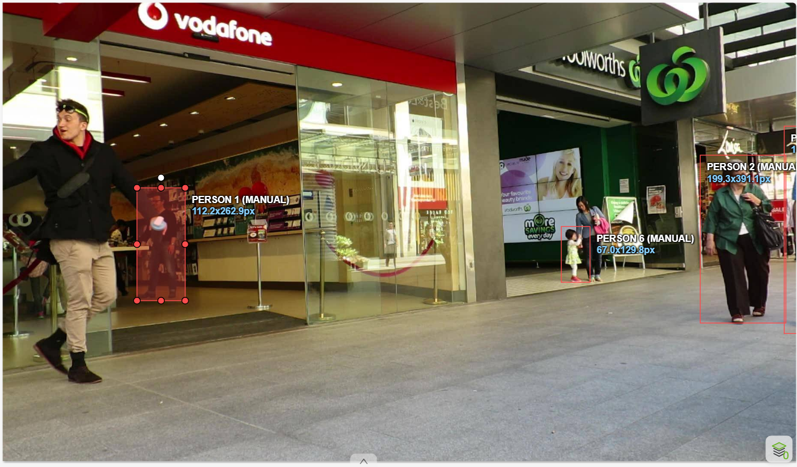
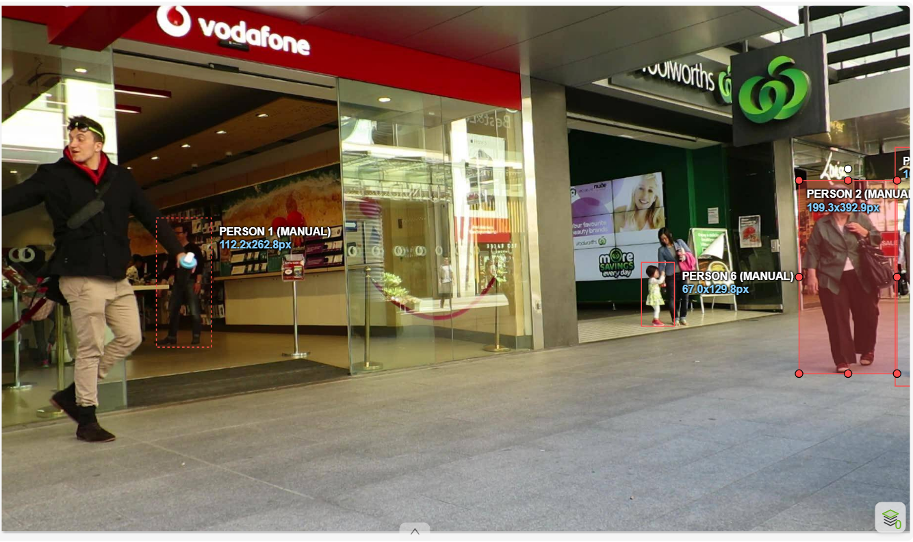
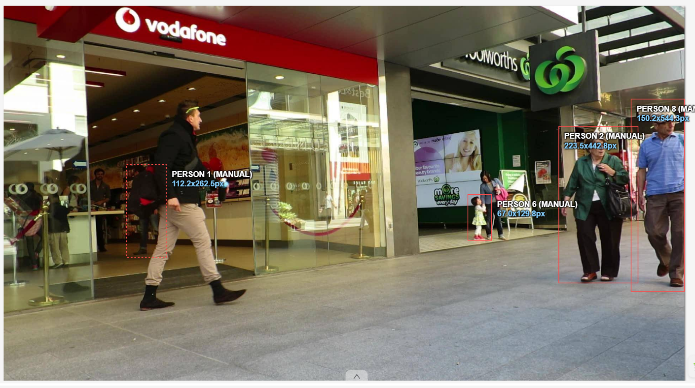

# Báo cáo cá nhân — HoVaTen-MSSV

Đổi tên file theo quy tắc `MSSV_HoTen.md`. Ví dụ: `20241234_NguyenVanAn.md`.

Đoạn video: MOT17-09, 150 frame (frame 1–150), nguồn MOTChallenge, giấy phép CC BY-NC-SA 3.0.

## 0. Thông tin học viên

- Họ tên: Kiều Xuân Bắc
- MSSV:2A202603317
- Mã đề (A/B/C):A
- Email: kieubac2006@gmail.com
- Link repository:https://github.com/kieubac2006-sudo/K5-L2B-day5-KieuXuanBac-2A202603317-MOTTracking
- Giờ bắt đầu:17h
- Giờ kết thúc:18h15

## 1. Xem trước đoạn video (CP0)

Ghi **trước khi vẽ**, mỗi người một dòng.

| Mã | Frame xuất hiện | Frame cuối thấy được | Rẽ / dừng / đổi tốc độ ở frame | Bị che ở frame | Ghi chú |
|---|---|---|---|---|---|
| P1 | 0| 149|100, 110 | 40-49| Đi ngang qua cửa hàng Vodafone, bị P2 che khuất hoàn toàn.|
| P2 |0 | 149|40, 100, 139 |Không bị che |Mặc áo khoác đen, đi ngang qua camera che P1. |
| P3 |0 | 148|100, 110|111-137 |Đi khuất sau chướng ngại vật rồi xuất hiện lại.|
| P4 |20 |149 |60, 90 |Không bị che | Xuất hiện trễ từ frame 20.|
| P5 |60 |149 | 100, 120|Không bị che |Xuất hiện trễ nhất từ frame 60. |

## 2. Keyframe và thời gian (CP1, CP4)

Số keyframe lấy từ kết quả `src/check_submission.py`.

| Mã | Số keyframe | Keyframe ở frame | Số frame có mặt | Keyframe / 100 frame | Thời gian (phút) | Chỗ khó |
|---|---|---|---|---|---|---|
| P1 |22 | [0, 10, 20, 28, 29, 30, 50, 54, 60, 70, 80, 89, 90, 91, 100, 103, 108, 110, 120, 130, 140, 149]|140 |15.7 |25 | Đoạn bị P2 che khuất phải căn chỉnh lại box Amodal liên tục.|
| P2 |19 |[0, 8, 10, 20, 30, 40, 50, 60, 70, 80, 90, 100, 104, 110, 120, 130, 139, 140, 149] |150 |12.7 |15 |Thay đổi tốc độ đi ở quanh frame 104 và 139. |
| P3 |10 |[0, 10, 20, 40, 100, 107, 110, 138, 140, 144] | 122|8.2 |8.2 |Đoạn biến mất khá dài (26 frame), phải nhớ bật tắt cờ outside.|
| P4 | 14| [20, 30, 40, 50, 60, 70, 80, 90, 100, 110, 120, 130, 140, 149]| 130|10.8 |15 |Khá dễ vì đi thẳng, tốc độ đều. |
| P5 | 10| [60, 70, 80, 90, 100, 110, 120, 130, 140, 149]| 90|11.1 | 10| Xuất hiện trễ, quỹ đạo đơn giản.|
| **Tổng** | 75| |632 |11.9 | 75| Việc xử lý cờ Occluded/Outside.|

Keyframe / 100 frame của cả bài = tổng keyframe ÷ tổng số frame có mặt × 100 = 75 ÷ 632 × 100 = 11.9 KF/100 frame.

Bạn đặt keyframe nhiều nhất ở người nào? Vì sao (người đó rẽ, dừng, lại gần camera hay bị che)?

Tôi đặt keyframe nhiều nhất ở P1 (Track 0) với 22 keyframe. Lý do là người này đi ngang qua cửa tiệm, có sự thay đổi tốc độ bước đi và đặc biệt là bị che khuất hoàn toàn bởi P2. Tại các điểm ngay trước và sau khi bị che (frame 28, 29, 30 và 50, 54), nội suy tuyến tính bị sai lệch nhiều do mất tầm nhìn, buộc tôi phải chèn nhiều keyframe thủ công (phím F) để ép box bám sát quỹ đạo thực tế.

## 3. Đoạn bị che (CP2)

Người bị che: `P1`

| Mốc | Frame |
|---|---:|
| Bắt đầu bị che một phần (bật `occluded`) |28 |
| Mất hẳn (bật `outside`) | 40|
| Hiện lại (tắt `outside`) | 50|
| Thấy rõ trở lại (tắt `occluded`) |54 |

- Thời gian khuất hẳn: _10__ frame = __0.33_ giây.
- Quyết định: giữ cùng ID (ID số 1) 
- Lý do (trả lời 3 câu: khuất bao lâu so với 60 frame, ngoại hình có khớp, chỗ hiện lại có đúng hướng và tốc độ):

P1 bị khuất hoàn toàn trong 10 frame, khoảng thời gian này nhỏ hơn rất nhiều so với ngưỡng 60 frame (2 giây) quy định của lớp. Khi xuất hiện lại ở frame 50, ngoại hình (áo len đen) hoàn toàn trùng khớp. Vị trí tái xuất hiện, hướng đi và tốc độ bước ra từ sau lưng P2 hoàn toàn liền mạch và hợp logic với quỹ đạo trước đó. Do vậy, phải tiếp tục giữ cùng ID cũ.

Ảnh chụp màn hình:





## 4. Tự review ID (CP3)

Lượt 1 theo người (đi ngược từ frame 149 về 0 trên CVAT), lượt 2 theo cảnh (nhảy 10 frame). Ít nhất 3 dòng; không có lỗi thì ghi một dòng "đã kiểm hai lượt, không lỗi".

Loại lỗi dùng đúng một trong 7 mã: `id_switch`, `fragmentation`, `lost`, `merge`, `false_track`, `drift`, `flag`.

| Frame | Mã người | Loại lỗi | Mô tả một câu | Phát hiện ở lượt | Đã sửa? |
|---:|---|---|---|---|---|
| 35|P1 |drift |Box trôi tụt lại phía sau người do P1 đi chậm lại khi bị che khuất. |Lượt 1 (Tua ngược) |Rồi, thêm KF. |
|112 | P3| false_track| Quên bật cờ Outside ngay frame 111, khiến box bị trôi lại màn hình trống 1 frame.|Lượt 2 (Xem xuôi toàn cảnh) |Rồi, sửa frame 111. |
|104 |P2 | drift|Box không chạm sát mép dưới bàn chân do P2 bước dài hơn. |Lượt 1 (Tua ngược) |Rồi, kéo lại box. |

Tổng hợp số lỗi theo loại:

| `id_switch` | `fragmentation` | `lost` | `merge` | `false_track` | `drift` | `flag` |
|---:|---:|---:|---:|---:|---:|---:|
|0 | 0|0 |0 |1 |2 |0 |

Lỗi nào chỉ lượt 2 (theo cảnh) mới thấy, lượt 1 (theo người) không thấy? Vì sao?

Lỗi false_track (hoặc quên bật outside kịp thời) thường dễ phát hiện hơn ở Lượt 2. Lý do là Lượt 1 tập trung chủ yếu vào độ khít (tightness) của bounding box với từng cá thể (có bị drift hay không). Trong khi đó, Lượt 2 xem toàn cảnh giúp mắt dễ dàng nhận ra các tương tác không hợp lý, ví dụ như người đã đi khuất vào góc chết của camera nhưng box vẫn còn kẹt lại lơ lửng trên màn hình.

## 5. File xuất và kết quả tự kiểm (CP4)

| Kiểm tra | Kết quả |
|---|---|
| Tên file MOT 1.1 |KieuXuanBac_mot.zip |
| Tên file CVAT for video 1.1 |KieuXuanBac_cvat_video.zip |
| Số track ID khác nhau trong `gt/gt.txt` (phải là 5) |Đạt (Đúng 5 Track ID) |
| Frame `outside` không có dòng trong `gt.txt` (đúng / sai) | Đúng|
| Job đã completed trên CVAT máy cá nhân | Đã Completed|

Dán phần tóm tắt in ra từ `src/check_submission.py`:

```text
Số frame in theo CVAT (bắt đầu từ 0). Trong gt.txt, frame_id = frame CVAT + 1.

=== File MOT 1.1: KieuXuanBac_mot.zip ===
  Số track ID: 5   |   Tổng số box: 632
  [OK]        Đúng 5 track ID.

  Track | Frame có mặt | Số frame | Đoạn vắng (outside)
      1 |   0–149      |      140 | 40–49
      2 |   0–149      |      150 | -
      3 |   0–148      |      122 | 111–137
      4 |  20–149      |      130 | -
      5 |  60–149      |       90 | -


=== File CVAT for video 1.1: KieuXuanBac_cvat_video.zip ===

  Track | Nhãn   | Frame thấy | Keyframe | KF/100 frame | Frame occluded | Lần bật outside
      0 | person |        140 |       22 |         15.7 |             16 |               1
              Track 0: keyframe ở frame [0, 10, 20, 28, 29, 30, 50, 54, 60, 70, 80, 89, 90, 91, 100, 103, 108, 110, 120, 130, 140, 149]
      1 | person |        150 |       19 |         12.7 |              0 |               0
              Track 1: keyframe ở frame [0, 8, 10, 20, 30, 40, 50, 60, 70, 80, 90, 100, 104, 110, 120, 130, 139, 140, 149]
      2 | person |        122 |       10 |          8.2 |              9 |               2
              Track 2: keyframe ở frame [0, 10, 20, 40, 100, 107, 110, 138, 140, 144]
      3 | person |        130 |       14 |         10.8 |             10 |               0
              Track 3: keyframe ở frame [20, 30, 40, 50, 60, 70, 80, 90, 100, 110, 120, 130, 140, 149]
      4 | person |         90 |       10 |         11.1 |             10 |               0
              Track 4: keyframe ở frame [60, 70, 80, 90, 100, 110, 120, 130, 140, 149]

  Tổng: 75 keyframe / 632 frame có mặt = 11.9 keyframe / 100 frame
  [OK]        Đọc được 5 track từ annotations.xml.

=== Tóm tắt ===
  Lỗi: 0   |   Cảnh báo: 0
  Đạt. Dán phần tóm tắt này vào báo cáo mục 5.
```

## 6. Ba câu kết

1. Nếu được gán lại, bạn sẽ đặt keyframe khác ở đâu? Vì sao?

   Nếu được gán lại, tôi sẽ chủ động đặt các keyframe dày hơn (khoảng 3-4 frame/KF) tại ngay trước các thời điểm có người đi cắt ngang mặt camera (như trường hợp P2 lướt qua P1) thay vì nhảy đều bước step 10. Sự thay đổi kích thước Amodal box khi bị che khuất rất dễ gây ra drift, việc gán KF dày hơn trước lúc bị che sẽ giúp thuật toán nội suy của CVAT ước lượng tuyến tính chính xác hơn ở các frame sau đó.

2. Có chỗ nào bạn không chắc "cùng ID hay ID mới"? Bạn đã quyết định và ghi chú thế nào?

   Chỗ khiến tôi phân vân nhất là khi P3 (Track 2) biến mất khỏi màn hình khá lâu từ frame 111 đến 137 (tổng 26 frame). Do đoạn này người đó ra khỏi mép khung hình và tái xuất hiện ở một vị trí góc khá hẹp. Tuy nhiên, chiếu theo luật ngưỡng 2 giây (60 frame) thì 26 frame vẫn nằm trong giới hạn an toàn. Tôi quyết định tắt outside và gán tiếp ID cũ vì nhận thấy trang phục và hướng bước đi ra khớp với quỹ đạo lúc biến mất.

3. Một lỗi ID trong job của bạn (nếu không còn sót, chọn lỗi đã sửa) có thể làm xe tự lái dự đoán sai chuyển động của người đó như thế nào? Lỗi đó ảnh hưởng MOTA hay IDF1 nhiều hơn?

   Nếu để xảy ra lỗi id_switch (ví dụ ở đoạn P1 tái xuất hiện sau khi bị P2 che, mà vẽ thành một người mới), hệ thống xe tự lái sẽ hiểu nhầm rằng người cũ (P1) đã biến mất hoàn toàn và một người mới bất ngờ "hiện ra" (ghost pedestrian) từ hư không. Điều này có thể khiến xe phanh gấp hoặc tính toán sai vector vận tốc dự đoán. Lỗi này sẽ ảnh hưởng cực kỳ nghiêm trọng đến IDF1 (tỉ lệ duy trì định danh đúng suốt video), trong khi MOTA bị ảnh hưởng ít hơn (MOTA chỉ trừ điểm False Negative/False Positive ở từng frame cục bộ).

## Bonus (nếu làm)

### B1 — Hai người đi sát

...

### B2 — So cách đặt keyframe

| Cách đặt | Số keyframe | Frame trôi nhất | Ghi chú |
|---|---:|---:|---|
| Đều mỗi 30 frame | | | |
| Theo chỗ đổi hướng | | | |

...

### B3 — So với tracker có sẵn

| Frame | Mã người | Tracker làm gì | Nhãn của bạn | Giải thích (đoán rồi sửa / ghép IoU / box score thấp / ngoại hình) |
|---:|---|---|---|---|
| | | | | |
| | | | | |

## 7. Tài liệu tham khảo và công cụ AI đã dùng

CVAT Cheatsheet & Guideline từ Github nội bộ môn học K5.

Bài báo gốc: "MOT16: A Benchmark for Multi-Object Tracking" (Milan et al., 2016).

Công cụ kiểm tra: check_submission.py và Offline Timeline Tool.

Trợ lý AI (Gemini) hỗ trợ đối chiếu thông số từ log đầu ra vào bảng báo cáo.
